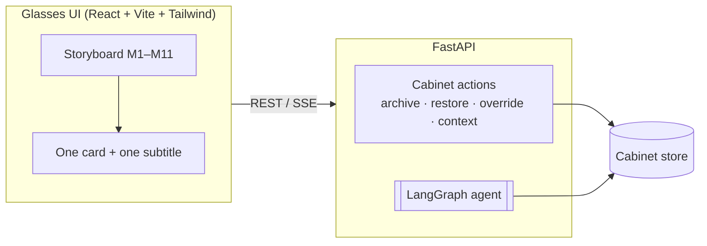
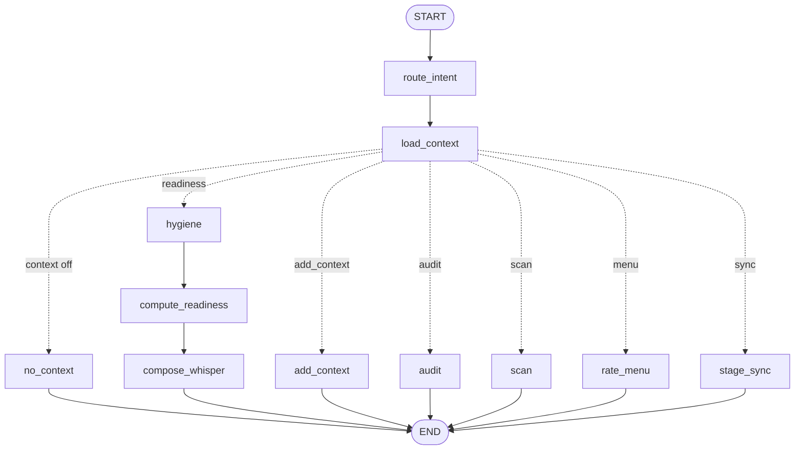

# Nordea: The Banking Context Cabinet

A smart-glasses concept prototype. Lauri stands in front of a flat near a Helsinki
metro stop and asks his glasses **"Am I on track to buy this flat?"**. The answer
comes from a LangGraph agent that reads his *Context Cabinet*: the goals he owns
and the signals Nordea has inferred about him. As he archives a stale goal and
corrects a wrong signal, the same question gets a better answer.

> Concept demo. Nordea is used as a plain-text wordmark only; all customer data is fictional.

## Planned: three-window presentation demo (mockup)

> Status: agreed concept, not built yet. This section describes a scripted
> audience demonstration, not a working system. It will run on fake data and
> staged responses; there is no real backend integration behind it.

For presentations, the same scripted story plays across **three windows on one
computer**, following the agreed flow:

```
User -> Personal Agent in the smart glasses -> Abel -> CM -> Nordea
```

- **Window 1 - Smart glasses (already built):** the existing multi-step story in
  this repository, with its audio interaction. Lauri speaks to the glasses and
  the agent answers out loud, with subtitles.
- **Window 2 - Context Cabinet (planned):** a standalone view that shows the
  Cabinet as a list of context cards. The cards appear, change and reorganise
  as the story progresses, so the audience can see which context is being used
  at each step.
- **Window 3 - Main-app chat (planned):** a chat view kept in sync with the
  glasses in real time. When Lauri says "Am I on track", the same words appear
  as his message in the chat. Abel's reply in the main app is word-for-word what
  the glasses reply, at the same moment.

The audience watches one conversation from three angles at once: what the user
experiences through the glasses, which context the agent is reading, and the
conversation as it appears in the app. Which storyboard moments the demo will
use is still open.

### What you see

- **The world:** a real street photo (`frontend/src/assets/street.jpg`) seen through a rounded glasses lens.
- **One AR card:** frosted glass with a glowing edge in the state colour (green on track, amber stale or tight, blue from Nordea, grey no context), pinned to the building by a thin leader line.
- **Subtitles, no buttons:** the glasses listen on their own. A small neon-green mic marks Lauri's words ("Listening" while it waits). A small speaker marks the agent, which also says its answer out loud. Text types on letter by letter.
- **The Context Cabinet as "Lauri's Active Agent Brain":** a glowing core with the Cabinet's memories orbiting it.
  - **Distance = relevance:** active memories float close to the core. Ones that need review sit further out. Stale ones drift to the edge and turn rust-orange (the 2023 car goal). No orbit rings are drawn; the orbs float freely.
  - **Colour = ownership:** emerald on the left is what Lauri declared. Blue on the right is what Nordea inferred. Rust-orange is a goal nobody has touched in a long time.
  - **Legend:** *Declared by you* (green), *Inferred by Nordea* (blue), *Rusty goal · untouched* (orange) and *Proposed by Personal AI* (dashed). Each label shows only while that kind of memory is in the Cabinet.
  - **Archive:** drag any memory into the Archive tray to archive it, or drag it back out to restore it.
  - **Tethers:** glowing lines join the core to the memories the agent is reading right now. The core shows the live answer.
  - **Sync AI ↔ Desync AI:** one pill in the Cabinet header. Before a sync it reads **Sync AI**; after a sync it reads **Desync AI**, which disconnects the Personal AI and empties the Cabinet (Lauri's memories and Nordea's). Then it flips back to **Sync AI**. The **+** pill adds context by hand.
  - **Provenance:** Nordea's inferred memories have a dashed edge; memories verified through the Personal AI carry a sparkle. The header shows Cabinet health ("2 items need review").
- **Personal AI sync (Zero-Trust Context Bridge):** one tap lets Lauri's own Personal AI propose updates. They land in a see-through **airlock** for review, and only the ticked cards reach the Cabinet. See below.


## How it works



The agent graph:



| Node | Job |
|---|---|
| `route_intent` | Decides what the user wants: readiness, add a note, audit a signal, or scan. LLM if configured, rules otherwise. |
| `load_context` | Loads the Cabinet. Context OFF short-circuits to `no_context`. |
| `hygiene` | Finds stale goals to archive and Nordea signals that need review. |
| `compute_readiness` | Calls the one readiness function. **The only place numbers are made.** |
| `compose_whisper` | Builds the bubble and caption. An LLM may rephrase the caption, but a guardrail rejects any number not produced by `compute_readiness` and any caption over 9 words. |
| `add_context` | Turns a spoken or typed note into a 2–4 word card ("Baby · autumn") and pins it. |
| `audit` | Explains a Nordea signal: what was seen, Nordea's interest, the verdict. |
| `scan` | Lists what Nordea knows, for the scan animation. |
| `stage_sync` | Stages the Personal AI's proposals in the airlock. Writes nothing; `POST /api/cabinet/{uid}/sync/apply` commits only the approved ids. |
| `rate_menu` | Rates every item on a menu the camera read against the lunch budget from the live flat goal. Context off: no judgement. |

Every turn runs with a LangGraph checkpointer (in-memory by default), so the agent
keeps a per-user thread. Swap in a Postgres checkpointer for persistence.

### The readiness model

All figures come from `backend/app/domain/readiness.py`:

- Savings = 18% × €4,050 = €729/mo. Deposit gap = €32,000 − €22,000 = €10,000.
- Car goal active → 25% reserved → €547/mo → ~18 months → **Tight**.
- Car goal archived → €729/mo → ~14 months → **On track** (4 to spare).
- Dining signal not corrected → loan estimate reduced. Corrected → restored.
- Tip: saving the raise too (25%) → €1,013/mo → ~10 months.

### The storyboard

| Moment | What happens |
|---|---|
| **M1 · Hook** | Lauri asks *“Am I on track?”*. His flat plan only lives in his Personal AI, so the Cabinet holds just the stale 2023 car goal and the agent answers about the wrong thing: **Car goal · ~82 mo** (“At €182/mo, your 2023 car goal needs ~82 months.”). At the same time a notification slides in: *Lauri's Personal AI · 4 updates for your Cabinet*. |
| **M2 · Personal AI sync** | The Cabinet opens (the agent is visibly reading the old car goal). **Sync AI** → Face ID and handshake → the **airlock** deck. Approve → the orbs reorganise. |
| **M3 · Same question** | He asks again: **On track · ~14 mo**, “Your 18-month plan vs your €22k ASP.” |
| **M4 · Desync** | In the Cabinet the pill now reads **Desync AI**. Tapping it disconnects the Personal AI: every memory, his and Nordea's, flies off and the Cabinet is empty. Asked again: **No goal to track** (“Set a goal to get an answer.”). |
| **M5 · Add by hand** | **+** opens a one-line sheet; Lauri types “Buy a flat in 18 months” himself (no Personal AI). Nordea then adds only the signals related to that goal: **ASP €22k** (toast: “Nordea added 1 related signal”). The answer is true but generic: **Keep saving · €22k saved, no target yet** (“€22k saved for a flat in 18 months. Keep going!”), because there's no deposit target, no partner, no raise, no dining context. |
| **M6 · Sync again** | **Sync AI** → the airlock. The first card now reads **Complete your flat goal** (it adds the partner, the metro area and the €32k deposit) instead of creating a new one. Approve → **On track · ~14 mo**, “Your 18-month plan vs your €22k ASP.” |
| **M7 · Quick add** | The glasses listen by themselves; “Expecting a baby next autumn” is pinned. |
| **M8 · Auto-scan** | What Nordea knows about him: 3 signals. |
| **M9 · Takeaway** | “Save the raise too → ~10 months.” |
| **M10–M11 · Restaurant** | Menu flags against the flat plan's €12 budget, then “Delete my flat goal” turns everything green. |

**Desync, step by step (M4–M6).** `POST /api/cabinet/{uid}/desync` moves every entry into a
`withheld` list. `POST /api/cabinet/{uid}/goals` adds the hand-typed goal
(`shared/manual_context.json`). `POST /api/cabinet/{uid}/nordea/contribute` brings back only the
Nordea entries related to the goals now in the Cabinet (`nordea_related`: a flat goal pulls in
savings, i.e. the ASP). A later sync restores what was withheld; entries added since then win
on id, and the flat goal Lauri typed is merged with the Personal AI's version (target, partner,
area).

### Personal AI sync: the Zero-Trust Context Bridge (M2)

His own assistant reads his calendar, notes and chats **on his device** and sends only
structured proposals (`shared/personal_agent_sync.json`). Nothing reaches the Cabinet until he
approves. The **Sync AI** pill only exists inside the Cabinet.

| Card | Badge | Impact when approved |
|---|---|---|
| Add your flat goal | Side A · From Personal AI | New goal: €32k deposit by spring 2028 (created in the Cabinet) |
| Archive the 2023 car goal | Staleness fix · AI verified | Frees the 25% of savings it reserved |
| Explain the dining spike | Side B link · Nordea + Personal AI | “Temporary: Q3 busy work sprint”; loan estimate restored |
| Confirm your raise | Side B · From Nordea | Lets the agent plan the raise into the flat |

**How the airlock looks.** A deck of cards at the bottom of the screen, stacked like books seen
from above, while the Cabinet orbit stays visible behind and shrinks into the space above the
deck. Each card shows only a title, one line of what it is, one line of impact, an
**Included / Skipped** toggle and a **Why?** pill. Swipe, use the arrows, or press → to go
through the cards; → on the last card approves. The memory the current card is about is
highlighted in the orbit, and the flat goal (which doesn't exist yet) shows as a dashed ghost
orb where it will land.

**One pop-up at a time.** **Why?** replaces the deck with the reason and where the data was
cited from (Notes, Calendar, Partner chat, Nordea, Files). **Safeguards** replaces it with
“where the model breaks”. Close either one (×, *Back to cards*, ← or Esc) and the deck comes
back on the same card.

**Where the model breaks:**

- **Hallucination guardrail:** “Let's quit our jobs and buy a vineyard in Italy” is read as a
  joke and blocked. Sync only proposes; it never auto-commits.
- **Advisory enclave firewall:** health and job-risk details (a health check-up, a startup
  interview) are stripped on-device and never reach the bank or credit underwriting.
- **Reality-check prompt:** an override isn't trusted forever. If restaurant spending stays
  high 60 days after the “Q3 sprint” note, the Cabinet asks again. In this prototype the rule
  is shown; nothing triggers it yet, because the demo has no transactions over time.

In the Cabinet, tapping the dining memory still offers both corrections by hand: **Q3 work
sprint** or **Kitchen reno**.

### Scene 2: the restaurant (M10–M11)

Lauri sits down for lunch at Field & Fork (`frontend/src/assets/restaurant.jpg`). The
glasses read the menu (`shared/menu_field_and_fork.json`, 27 items) and the agent marks
every item next to its price, using `backend/app/domain/menu.py`:

- While the flat goal is live, its lunch budget applies: **€12 per dish** (`lunch_cap` on
  the goal in `shared/lauri.json`, an assumed figure for the demo). Five dishes are over
  and get an amber flag with the amount (Burger +€2.50, Harvest Bowl +€1.50, Pasta +€3.00,
  two sandwiches +€0.50 and +€1.50). Everything else gets a green check.
- The restaurant starts from the synced Cabinet. In M11 Lauri says "Delete my flat goal". The goal goes to the archive, there's no
  budget to protect, and every marker turns green.
- With context off (API `context_on: false`), the agent says it can't judge prices and shows no markers.

`shared/readiness_cases.json` lists the expected results. Both `pytest` and
`vitest` check against it, so the backend and the offline UI can't drift apart.

## Repository layout

```
backend/            FastAPI + LangGraph agent (Python 3.11+)
  app/domain/       models, readiness function, whisper templates + guardrail
  app/agent/        graph, state, LLM factory, LangGraph Studio entry
  app/main.py       HTTP API
  tests/            pytest: readiness, agent paths, API walkthrough, fake-LLM guardrail
frontend/           Glasses UI (React 19, Vite, Tailwind 4)
  src/config/moments.js   storyboard table: timings and moment views
  src/config/scene.js     the street photo and where cards pin in it
  src/components/Orbit.jsx  the Context Cabinet as the Agent Brain
  src/components/SyncAirlock.jsx  Personal AI sync review (airlock + safeguards)
  src/lib/orbit.js        orbit layout (distance bands, hemispheres, no overlaps)
  src/lib/api.js          backend client, falls back to offline mode
  src/lib/localAgent.js   offline agent for static hosting
shared/             seed Cabinet (lauri.json), Personal AI sync proposals, menu, shared test cases
.github/workflows/  CI (tests + builds) and GitHub Pages deploy
.devcontainer/      one-click GitHub Codespaces setup
```

## Run it

### Option A: Docker (one command)

```bash
docker compose up --build
```

Open http://localhost:8080 for the glasses UI and http://localhost:8000/docs for the API.

### Option B: Local dev

Needs Python 3.11+ and Node 22+.

```bash
make install   # backend venv + frontend packages
make dev       # API on :8000, UI on :5173 (Vite proxies /api to the API)
```

Without `make`:

```bash
cd backend && python3 -m venv .venv && . .venv/bin/activate
pip install -r requirements-dev.txt
uvicorn app.main:app --reload --port 8000
# second terminal
cd frontend && npm ci && npm run dev
```

### Turn on an LLM (optional)

The agent works with no API key. To let a model route free-form questions, rephrase
captions and title notes, copy `.env.example` to `.env` and set:

```bash
LLM_PROVIDER=anthropic          # or openai, google
ANTHROPIC_API_KEY=...
# LLM_MODEL=...                 # required for openai and google
```

For local dev without Docker, also `pip install -r backend/requirements-llm.txt`
and export the variables before starting the API. The Cabinet footer shows
which mode the UI is in (`Live agent · LLM: …` or `Offline demo`).

## Use the prototype

| Action | How |
|---|---|
| Next / previous moment | → / ← keys, the arrow buttons, or tap the right half of the screen |
| Do the moment's action | → opens the Cabinet, starts the sync, steps through the cards and approves (M2, M6), desyncs (M4), adds the typed goal (M5), speaks (M7), finishes the scan (M8), deletes the goal (M11) |
| Speak a note | Nothing to press: M7 starts listening by itself (preset line by default). Turn on **Live mic** in the Cabinet for real speech recognition (Chrome or Edge) |
| Agent voice | Answers are spoken with the browser's speech synthesis. Turn off with **Voice** in the Cabinet |
| Type a note or ask anything | Keyboard button. Text ending in `?` goes to the agent as a question |
| Open the Cabinet | Cabinet button, the vault icon, or the "3 from Nordea" chip |
| Inspect a memory | Tap an orb for its details and actions (Archive, Why?, Not right, Restore) |
| Archive / restore | Drag an orb into the Archive tray, or back out of it |
| Personal AI sync | Tap the notification (or the Cabinet button, which shows a badge), then **Sync AI** in the Cabinet. Saying or typing “sync” does the same. → next card, ← previous card, Esc closes a pop-up, then the airlock |
| Restaurant scene | M10 and M11. Removing the flat goal (→ in M11, or drag it to the Archive) turns every menu marker green |
| Desync / add by hand | **Desync AI** in the Cabinet empties it (saying or typing “desync” does the same); **+** adds a line of context yourself. The street stays visible behind the Cabinet |

## Test it

```bash
make test          # pytest + vitest
```

What's covered:

- **Readiness**: every case in `shared/readiness_cases.json`, restore, notes don't change numbers.
- **Agent**: each graph path, the per-turn trace, thread memory, and a fake LLM that proves the guardrail accepts valid captions and rejects invented numbers.
- **API**: a Cabinet walkthrough over HTTP (context off, archive, audit, correct, add, scan, takeaway), 404s, the event stream.
- **Personal AI sync**: the first answer anchors on the old car goal, sync creates the flat goal, staging writes nothing, the default sync gives On track · ~14 mo, only approved proposals are written, unknown ids are rejected, the same results offline.
- **Desync**: the Cabinet empties (No goal to track), a hand-typed goal plus Nordea's related ASP gives the generic “Keep saving” answer, and a re-sync restores everything and completes the flat goal (On track · ~14 mo), backend and offline.
- **Menu**: 5 of 27 items over the €12 budget, all green once the flat goal is gone, no judgement with context off, and the same results from the offline agent.
- **UI**: the offline agent against the same shared cases, and the orbit layout at phone, tablet and laptop sizes (side per owner, distance per freshness, no overlapping pills, nothing on top of the core).

Try the API directly:

```bash
curl -s -X POST localhost:8000/api/agent/lauri/ask \
  -H 'Content-Type: application/json' -d '{"question":"Am I on track to buy this flat?"}'

curl -s -X POST localhost:8000/api/agent/lauri/menu -H 'Content-Type: application/json' -d '{}'   # rate the demo menu

curl -s -X POST localhost:8000/api/agent/lauri/sync/stage                                   # proposals → airlock
curl -s -X POST localhost:8000/api/cabinet/lauri/sync/apply -H 'Content-Type: application/json' \
  -d '{"approved_ids": ["sync-car-stale", "sync-dining-override"]}'                      # commit only these

curl -s -X POST localhost:8000/api/cabinet/lauri/desync                 # empty the Cabinet
curl -s -X POST localhost:8000/api/cabinet/lauri/goals -H 'Content-Type: application/json' -d '{}'   # "Buy a flat in 18 months"
curl -s -X POST localhost:8000/api/cabinet/lauri/nordea/contribute       # Nordea adds the related ASP → generic answer

curl -s -X POST localhost:8000/api/cabinet/lauri/entries/car/archive
curl -s -X POST localhost:8000/api/agent/lauri/answer        # now "On track · ~14 mo"

curl -N -X POST localhost:8000/api/agent/lauri/ask/stream \
  -H 'Content-Type: application/json' -d '{"question":"Can I afford it?"}'   # one event per node
```

### Inspect the graph in LangGraph Studio

```bash
make studio        # installs langgraph-cli[inmem] and runs `langgraph dev` in backend/
```

Studio opens in the browser. Pick `cabinet_agent` and run it with
`{"user_id": "lauri", "question": "Am I on track to buy this flat?"}` to watch each node.

### Share it as one file

```bash
cd frontend && npm run build:single   # → frontend/dist-single/index.html
```

A single self-contained HTML page (photo included) running the offline agent. Open it in any browser or attach it to an email.

## Put it on GitHub

```bash
cd nordea-context-cabinet
git init -b main
git add .
git commit -m "Nordea Context Cabinet prototype"
gh repo create nordea-context-cabinet --private --source . --push
# or: create an empty repo on github.com, then
# git remote add origin https://github.com/<you>/nordea-context-cabinet.git && git push -u origin main
```

Then:

1. **CI** runs automatically on every push: backend tests, UI tests and build, Docker build. See the Actions tab.
2. **Clickable demo link (no backend):** Settings → Pages → Source: **GitHub Actions**. The `pages.yml` workflow publishes the UI in offline mode at `https://<you>.github.io/nordea-context-cabinet/`. GitHub Pages on a private repo needs a paid plan; make the repo public or use Codespaces instead.
3. **Full stack in the browser:** Code → Codespaces → Create. When it opens, run `make dev`. The UI opens on the forwarded port 5173. Add `ANTHROPIC_API_KEY` etc. as Codespaces secrets to test with an LLM.

> **Photo rights:** check you may publish `frontend/src/assets/street.jpg` and `restaurant.jpg` before making the repo or Pages site public. To swap it, replace the file, update `width`/`height` in `src/config/scene.js`, and move the anchors onto the matching objects.

## From prototype to production

- **Data:** replace `InMemoryCabinetStore` (same methods) with a database, and the seed with the customer's real goals and Nordea signals.
- **Memory:** pass a Postgres or Redis checkpointer to `build_graph(checkpointer=...)`.
- **Auth:** the API trusts the `{uid}` in the path. Put it behind real authentication and derive the user from the session.
- **Demo endpoints:** set `DEMO_MODE=0` to remove `/api/demo/*`.
- **Consent:** every Nordea-inferred signal already carries an audit trail (`seen`, `interest`, `verdict`); keep it when wiring real data.
- **Glasses hardware:** the UI is a web app, so it runs in a phone browser today. Turn on `Camera` in the Cabinet to put the AR layer over the live camera feed, or set `VITE_BACKGROUND_URL` to another photo and move the anchors in `src/config/scene.js`.
